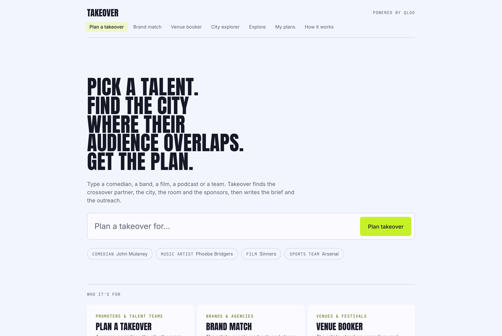
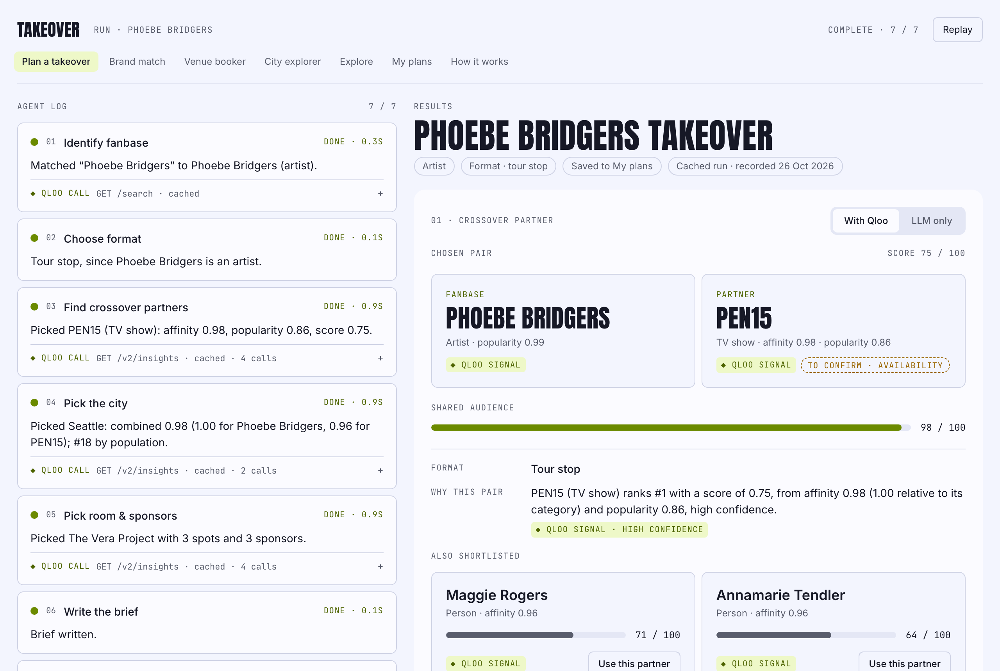
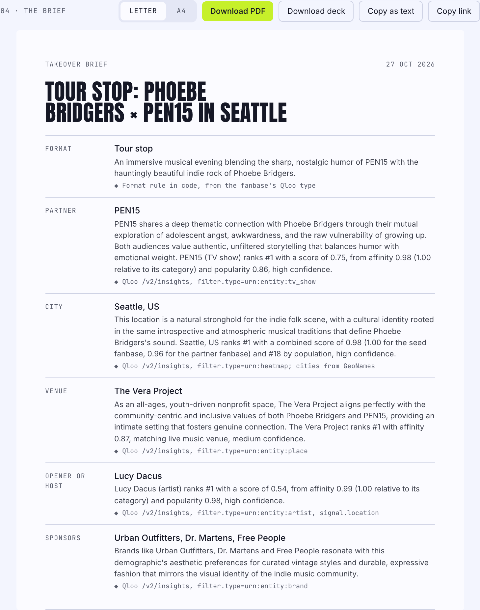
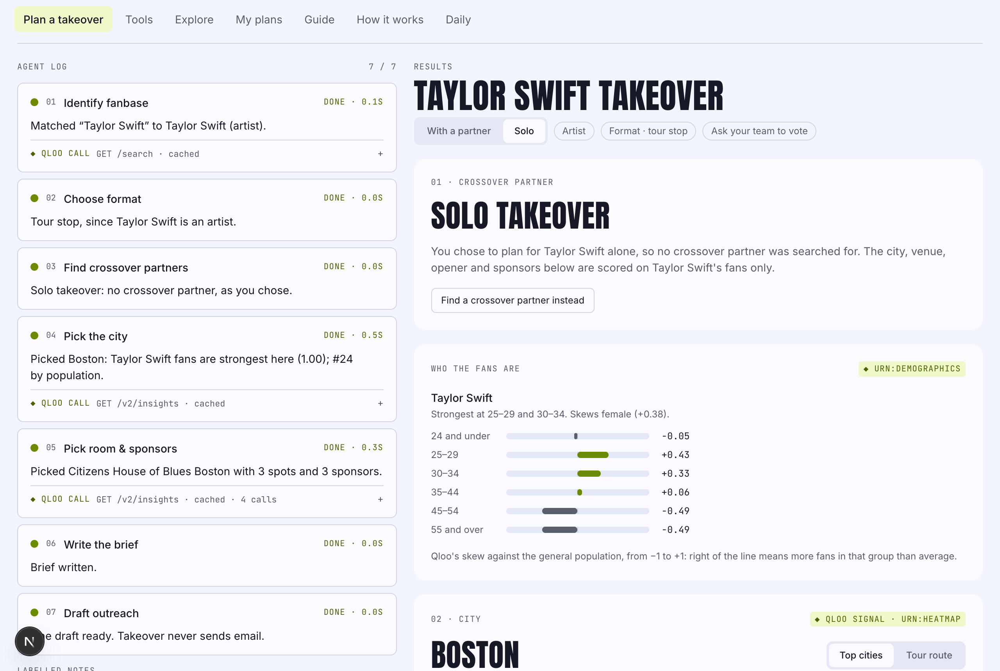
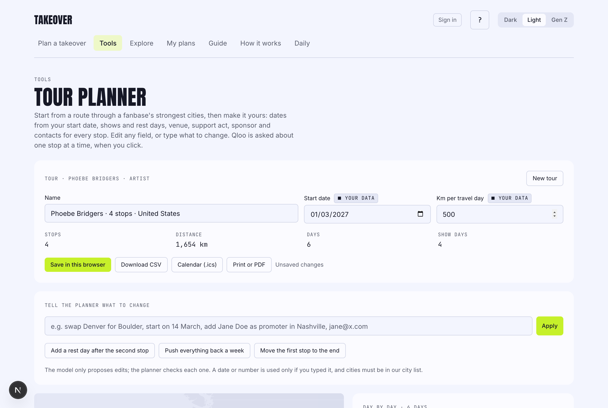
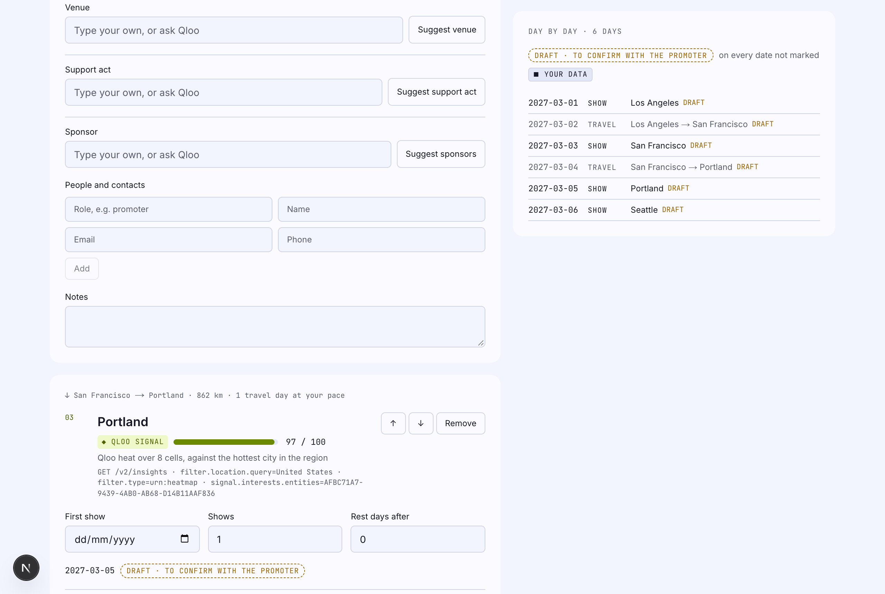
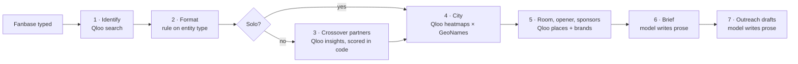
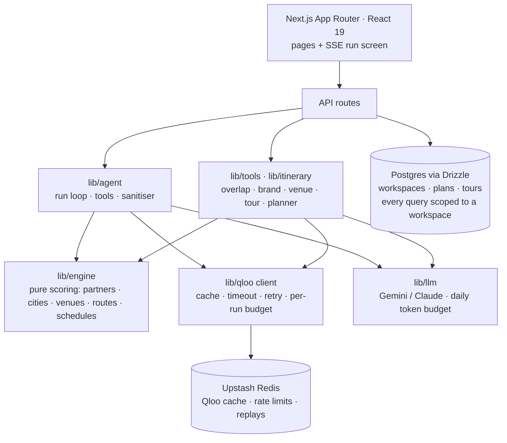

# Takeover

**Type any fanbase. Get the event.**

**Live: [takeover-fawn.vercel.app](https://takeover-fawn.vercel.app)**. Try *Phoebe Bridgers*, or
pick *Solo* and try *Taylor Swift*. The preloaded examples open instantly.

A comedian, a band, a film, a podcast, a football club: Takeover finds the crossover partner whose
fans overlap most, the city where both audiences over-index, the room, the opener and the sponsors.
Then it writes the one-page brief and the outreach. Or it routes the whole tour, day by day.

Every pick is measured on the [Qloo Taste AI API](https://docs.qloo.com/) and scored by code you can
read in [`lib/engine/`](lib/engine). The language model writes the words, and it is never allowed to
produce a number.



---

## The problem

Event planning runs on gut feel and population tables. Ask a chatbot to plan a crossover for
Phoebe Bridgers and it answers **A24 in Los Angeles**: the famous partner and the biggest city,
with nothing measured and nothing cited.

Takeover answers **PEN15 in Seattle**, and shows why. Seattle ranks **#1 for the overlap** between
the two audiences and **#18 by population**. That gap is the product: it finds the city a
population table would never pick.


The "LLM only" tab sits on every plan. It asks the same model the same question with no taste data,
so the difference Qloo makes is visible in one click.

## What makes it trustworthy

| Rule | How it is enforced |
| --- | --- |
| **Numbers come from code, never the model.** | Scores, ranks and distances are computed in `lib/engine` (pure, unit-tested functions). The model writes prose with placeholders such as `{city}` and `{venue}`; code fills in the names, and a sanitiser strips any number or claim the model slips in ([`lib/agent/sanitize.ts`](lib/agent/sanitize.ts)). |
| **Every claim shows its source.** | Each pick carries its evidence sentence and the Qloo request behind it. The agent log shows every endpoint and parameter; the brief keeps each claim next to its source and confidence. |
| **Unknowns stay unknown.** | Capacity, prices and availability are shown as *"to confirm with the promoter"*, never guessed. |
| **Nothing fails silently.** | Every step has a labelled fallback: a picker for ambiguous names, "did you mean" for typos, regional overlap when city data is thin, the nearest city when no venue is tagged, template wording when the model is down. |
| **Your data is never blended into Qloo's.** | What you enter (dates, fees, ticket sales) carries a **Your data** label and sits next to Qloo signal, never mixed into it. |
| **It can't run away with a budget.** | Hard caps of 25 Qloo calls and 8 agent turns per run. Per-visitor and daily run limits, and a daily model-token budget. Every Qloo call goes through one client with a cache, timeout, retry and budget. |

## See a run

Each step in the agent log shows the Qloo call behind it. The results show the score, the evidence
and the shortlist, with **Use this partner** and **Use this city** to re-plan from that step.




The brief downloads as a PDF or a deck, copies as text, or shares as a link with a preview card.



## Solo or crossover: your call

Not every act needs a partner. Taylor Swift is big enough on her own. Pick **Solo** on the search
box (or flip the switch on any plan) and Takeover skips the partner. It ranks cities by the
fanbase's own heat, finds the room, opener and sponsors for that audience alone, and drafts one
email, to the venue. A solo run makes about 4 Qloo calls instead of about 10.



## Tour planner: from route to run sheet

The **Tour optimizer** (`/tour`) picks the best route through a fanbase's strongest cities, inside your
constraints: number of stops, longest drive, start and end, cities to keep or skip. Every leg is
measured, and strong cities left off say why. The **Tour planner** turns that route into an
itinerary you can actually work from:

- **A draft schedule from your start date.** Code works out show days, travel days (from each leg's
  distance at your pace) and rest days. Every computed date is labelled *Draft · to confirm with
  the promoter*. Type a date on a stop to pin it, and later dates follow.
- **Suggestions when you ask for them.** Each stop has *Suggest venue*, *Suggest support act* and
  *Suggest sponsors* buttons. Qloo is called only for the one you click; take its pick or type your
  own.
- **Edit in plain words.** *"Swap Portland for Boulder, start on 14 March, add a rest day after
  Seattle, venue in Seattle is The Showbox."* The model turns the sentence into structured edits.
  Code then checks every one before applying it: a date or number is accepted only if it appears
  in what you typed, and each city must be a real one. You see what changed, with Undo.
- **People and notes per stop.** Promoter, venue contact, crew.
- **Export** to CSV, a calendar file (.ics) for Google, Apple or Outlook, or a printable PDF.
  Save it to your team's workspace or keep it in the browser.





## Everything in the box

**Plan and explore** (no account needed)

| Tool | You enter | You get |
| --- | --- | --- |
| **Plan a takeover** (`/`) | A fanbase, crossover or solo | Partner, city, venue, opener, sponsors, who the fans are, brief, outreach drafts |
| **Fan overlap** (`/overlap`) | Two names | How strongly each side's fans over-index on the other, where both are strong, both audiences' age and gender |
| **Meet the fan** (`/fan`) | A fanbase | Who its fans are and what else they love, as a shareable card |
| **Brand match** (`/brand`) | A brand | The talent, shows and podcasts its customers over-index on, and its strongest cities |
| **Venue booker** (`/venue`) | A city (typos forgiven) | The artists, comedians, podcasts and brands people there over-index on |
| **City explorer** (`/cities`) | A fanbase | Its strongest cities at home and in three more countries, on one map |
| **Tour optimizer** (`/tour`) | A fanbase and your constraints | The best route, every leg measured, and why strong cities were left off |
| **Tour planner** (`/tour/planner`) | A route and a start date | An editable, exportable day-by-day itinerary |
| **Lineup optimizer** (`/lineup`) | A pool of acts, fee tiers and a budget | The bill with the strongest shared audience, and a festival poster |
| **City pages** (`/city/<name>`) | – | What each big city over-indexes on, one page each |
| **Takeover Daily** (`/daily`) | – | A daily puzzle: guess Qloo's partner, city and sponsor; keep a streak, share your grid |

**For teams** (sign in with Google or an email link)

| Feature | What it does |
| --- | --- |
| **Workspace plans** | Plans saved for your team, private by default, with a public link when you want one |
| **Rosters** | Group the acts you represent: each act's best city, partner and sponsor, and the pairings inside the roster |
| **Pipeline** | Track outreach from first draft to confirmed date, with owners, due dates and reminders |
| **Market watch** | Follow fanbases and cities; every Monday Takeover re-checks Qloo and lists what changed |
| **Sponsorship matchmaker** | Match a brand with talent and events whose fans over-index on it, from either side |
| **Your data** | Upload a ticketing or CRM export and see it next to Qloo signal, with a weight you set |
| **Outcomes** | Log what happened after an event and compare it with what the plan predicted |
| **Campaign brief** | A targeting brief: audience, interests by category, cities, ad keywords, creative angles |
| **Members and comments** | Admins, members and viewers; comment and @mention on any decision |
| **Branded decks, white-label, public API** | Exports in your colours, plans and widgets on your own domain, and every tool over REST (`/developers`) |

Nothing is ever sent on your behalf. Outreach stays a draft until you click Send on that exact
message, and the model has no send tool.

## How a plan is made



| Step | What happens | Where the answer comes from |
| --- | --- | --- |
| 1. Identify the fanbase | One clear match, a picker for several, "did you mean" for a misspelling | Qloo `/search`, name matching in code |
| 2. Choose the format | Tour stop, live show, screening tour or fan fest | A rule on the Qloo entity type |
| 3. Find crossover partners | Candidates from other categories, scored on affinity relative to their category, with a popularity guard (skipped for a solo takeover) | Qloo `/v2/insights`, [`lib/engine/partners.ts`](lib/engine/partners.ts) |
| 4. Pick the city | Both audiences' heatmaps in the home market, combined per city; for a solo takeover, the fanbase's own | Qloo heatmaps, GeoNames, [`lib/engine/cities.ts`](lib/engine/cities.ts) |
| 5. Room and sponsors | Venue, opener, after-show spots and sponsor brands in that city | Qloo places and brands, [`lib/engine/places.ts`](lib/engine/places.ts) |
| 6. Write the brief | Prose with placeholders; code fills names, scores and sources | Gemini (or Claude), then the sanitiser |
| 7. Draft outreach | To the partner and the venue (solo: the venue). Drafts only | Same model, same sanitiser |

By default, code runs the steps and makes every pick, and the model is called **once**, to write
the brief and the emails. `TAKEOVER_PLANNER=agent` hands tool choice to the model instead. Preloaded
examples replay instantly and cost nothing. The scoring formulas, with the numbers the code uses,
are on the in-app **How it works** page (`/method`).

## Architecture



- **Next.js (App Router), React 19, TypeScript, Tailwind CSS 4**, built from a Claude Design
  handoff.
- **Qloo Taste AI API** for every partner, city, venue, opener, sponsor and audience.
- **Gemini** through the official Google Gen AI SDK, with automatic fallback across models when one
  is overloaded or out of quota. `LLM_PROVIDER=anthropic` uses Claude.
- **Upstash Redis** for the Qloo cache, rate limits, the token budget and replayed examples.
- **Postgres with Drizzle** for teams: Neon in production, an in-process PGlite locally, the same
  migrations for both. A test fails if any query touches a team's table without its workspace id.
- **Auth.js** with Google sign-in and email magic links, **Resend** for email, **Stripe** (test mode) for plans.

## Built to be checked

- **Over 500 unit tests** across scoring, the agent loop, the sanitiser, the Qloo client, exports,
  the tour planner and every workspace feature. There are also **17 Playwright end-to-end suites**.
- **CI on every push and pull request** ([`.github/workflows/ci.yml`](.github/workflows/ci.yml)):
  lint, typecheck, tests, production build, a check that a mock-data build is refused in
  production, a secret scan of the bundles, and the end-to-end suites.

## Run it locally

```bash
npm ci                       # installs exactly the lockfile
cp .env.example .env.local   # add your keys, or skip them and use sample data:
TAKEOVER_MOCK=1 npm run dev  # http://localhost:3000, sample data, labelled as such
```

With `QLOO_API_KEY`, `QLOO_BASE_URL` and `GEMINI_API_KEY` set, `npm run dev` runs on live data.
Locally, everything else has a fallback:

- **No model key:** template wording.
- **No Upstash:** caches and limits kept in memory.
- **No database:** PGlite in `.data/`.
- **No email:** sign-in links appear at `/dev/outbox`.

You also need an `AUTH_SECRET` for sign-in; generate one with `openssl rand -base64 32`.

> **On macOS, keep the project outside iCloud-synced folders** (Desktop and Documents, when
> "Desktop & Documents Folders" is on). iCloud evicts and re-syncs `node_modules` and `.next`,
> which stalls the dev server.

## Deploy (Vercel)

1. Create a Postgres database. [Neon](https://neon.tech) has a free tier; Vercel's Postgres
   integration is Neon too. Upstash is Redis, not Postgres, so you need both.
2. Set the environment variables below in Vercel, for Production.
3. Run the migrations against it once: `DATABASE_URL_UNPOOLED=<direct url> npm run db:migrate`.
4. Deploy. The build fails on purpose if `TAKEOVER_MOCK=1` is set for production.

| Variable | Needed for |
| --- | --- |
| `QLOO_API_KEY`, `QLOO_BASE_URL` | All taste data |
| `GEMINI_API_KEY` (or `LLM_PROVIDER=anthropic` + `ANTHROPIC_API_KEY`) | Brief, emails, tour planner edits; required in production |
| `UPSTASH_REDIS_REST_URL`, `UPSTASH_REDIS_REST_TOKEN` | Qloo cache, rate limits, token budget, examples |
| `DATABASE_URL` (pooled), `DATABASE_URL_UNPOOLED` (direct, for migrations) | Accounts, workspaces, saved plans and tours; required on Vercel |
| `AUTH_SECRET` | Sign-in sessions |
| `AUTH_GOOGLE_ID`, `AUTH_GOOGLE_SECRET` | "Continue with Google" sign-in; redirect URI `https://<your-domain>/api/auth/callback/google` |
| `RESEND_API_KEY`, `EMAIL_FROM` | Email-link sign-in and invites (the dev outbox is off on Vercel); optional when Google sign-in is set |
| `APP_URL` | Links in emails and Stripe returns |
| `STRIPE_*`, `QSTASH_*`, `BLOB_READ_WRITE_TOKEN`, `CONTACT_EMAIL` | Optional: billing (test mode), background jobs, uploads, contact form |

Limits are configurable: `LLM_DAILY_TOKEN_BUDGET` (default 2,000,000), `TAKEOVER_DAILY_RUNS`
(default 120), `QLOO_DAILY_CALL_CAP`, `QLOO_WORKSPACE_MONTHLY_CALLS`. Every value is server-side
only; see [`.env.example`](.env.example). `GET /api/health` reports Qloo, Redis, the model, today's
token use and the run limits, with no secrets.

### Scripts

| Command | Does |
| --- | --- |
| `npm run dev` / `npm run build` | Dev server / production build |
| `npm run check` | Lint, typecheck and unit tests |
| `npm run test:e2e` | Playwright end-to-end tests (sample data) |
| `npm run db:migrate` | Apply Drizzle migrations to `DATABASE_URL_UNPOOLED` |
| `npm run warm-cache` | Preload the examples into Redis from real runs |
| `npm run scan:secrets` | Fail if a key or `.env` file is in the bundles or the repo (after a build) |
| `npm run probe` | Record raw Qloo responses into `tests/fixtures/` |

### API

| Route | Does |
| --- | --- |
| `POST /api/plan` | `{query, overrides?}` (`overrides.solo: true` for a solo takeover) → a stream of step events (SSE) and the final plan |
| `POST /api/llm-only` | `{query}` → the same model's answer with no tools or Qloo data |
| `POST /api/tools/overlap` · `brand` · `venue` · `cities` · `tour` · `audience` | The tools above, as JSON |
| `POST /api/tools/tour/suggest` | `{fanbaseId, cityId, kind}` → venue, support act or sponsor picks for one tour stop |
| `POST /api/tour/planner/edit` | `{itinerary, instruction}` → checked edit operations from plain words |
| `GET /api/suggest?q=` | Up to six Qloo matches for the search box |
| `/api/v1/*` | The public REST API for workspaces, with API keys (`/developers`) |
| `GET /api/health` | Service status and limits; no secrets |

## Project layout

| Path | Purpose |
| --- | --- |
| [`lib/engine/`](lib/engine) | All scoring: partners, cities, venues, sponsors, routes, lineups (pure functions) |
| [`lib/agent/`](lib/agent) | The run loop, tools, planners and the prose sanitiser |
| [`lib/qloo/`](lib/qloo) | Qloo client (cache, timeout, retry, budgets) and response mapping |
| [`lib/llm/`](lib/llm) | Model providers (Gemini, Anthropic) and the daily token budget |
| [`lib/tools/`](lib/tools), [`lib/itinerary/`](lib/itinerary) | The standalone tools, and the tour planner's schedule, edits and AI parsing |
| [`lib/db/`](lib/db), [`lib/workspace/`](lib/workspace) | Schema, the workspace-scoped repository, sessions and permissions |
| `app/`, `components/` | Pages, API routes and UI |

## Data credits

City names, regions, coordinates and populations come from [GeoNames](https://www.geonames.org/)
(`cities15000`), licensed under [CC BY 4.0](https://creativecommons.org/licenses/by/4.0/). We keep
cities with population of 100,000 or more in `lib/engine/data/cities.json`; regenerate it with
`npx tsx scripts/build-cities.ts`.

Posters use [Anton](https://github.com/googlefonts/AntonFont) under the SIL Open Font License
(`lib/fonts/OFL-Anton.txt`).

Map outlines come from [Natural Earth](https://www.naturalearthdata.com/) (public domain) via
[world-atlas](https://github.com/topojson/world-atlas) (ISC), served from `public/geo/`.

## License

MIT. See [LICENSE](LICENSE). Third-party data keeps its own licence (see Data credits).
