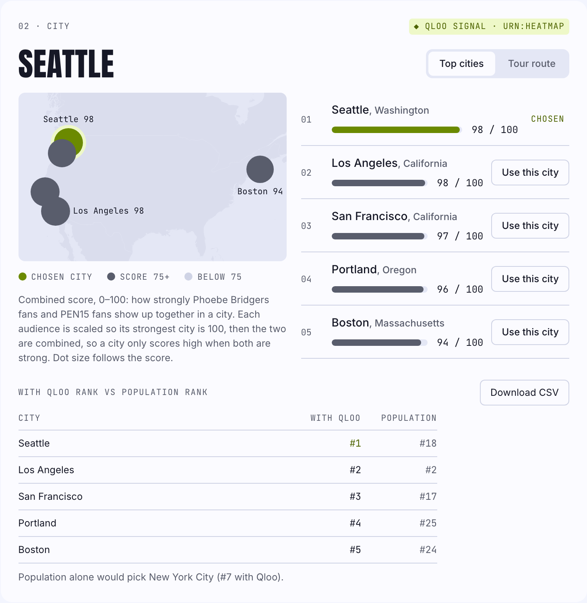
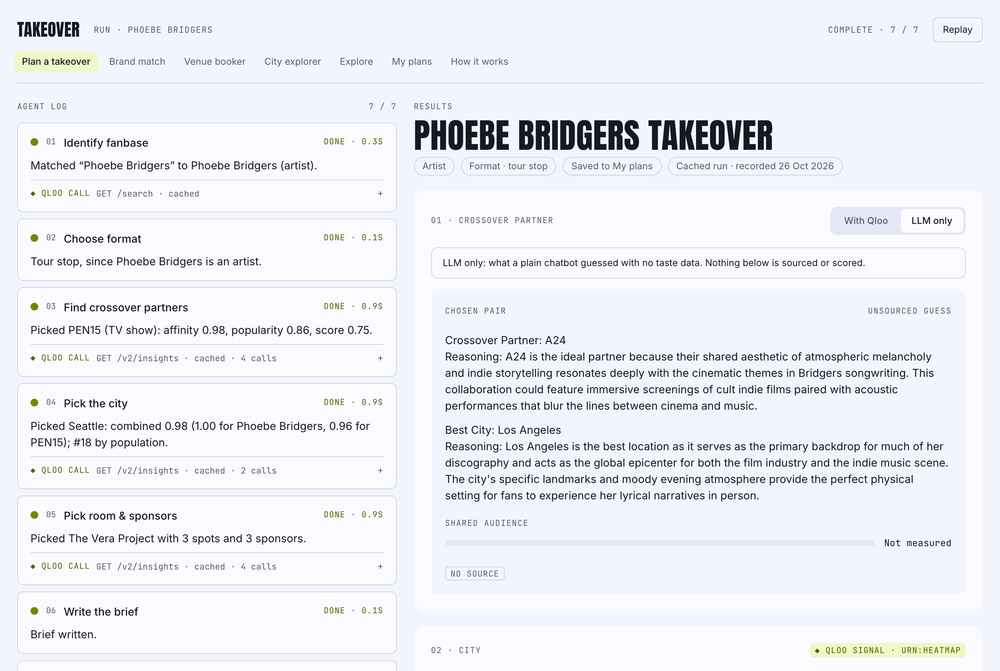
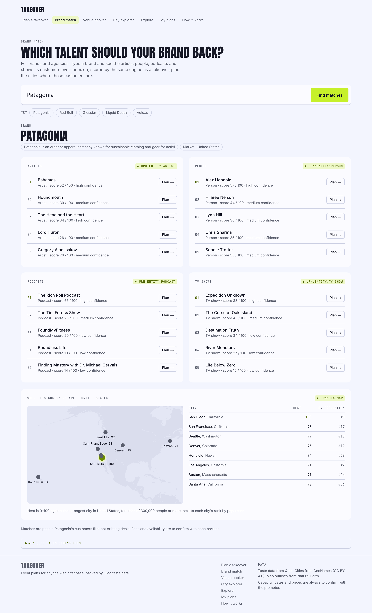
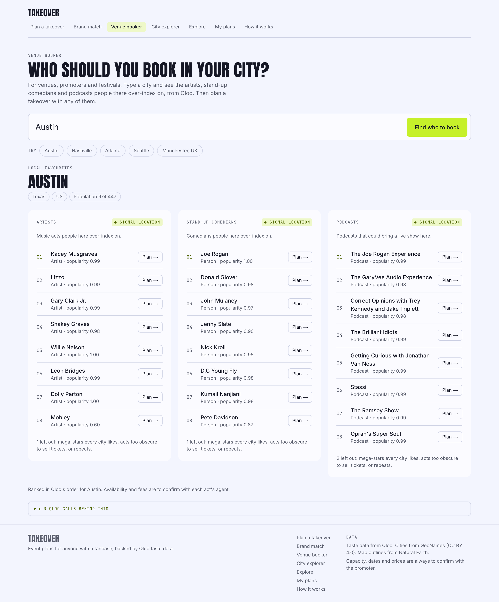
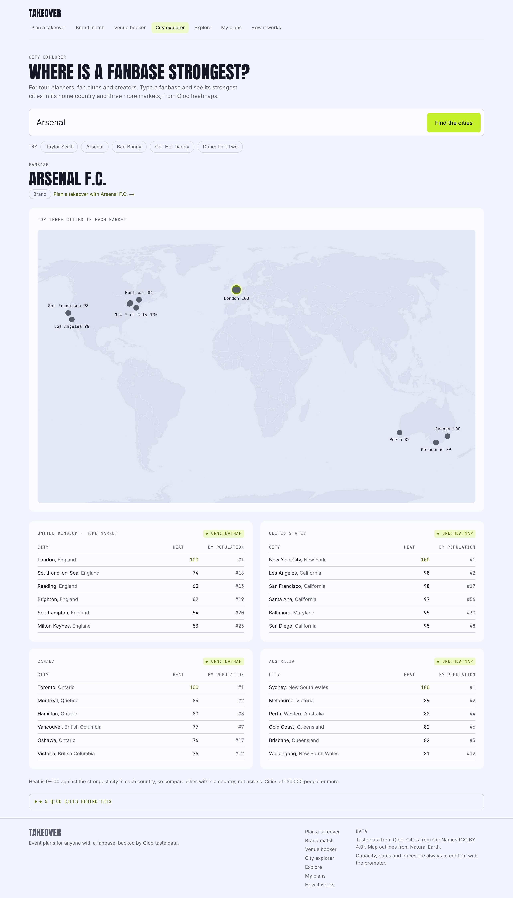
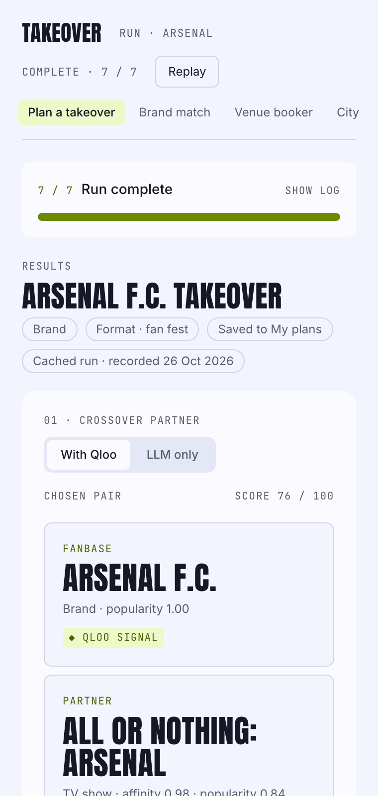

# Takeover

Event planning for anyone with a fanbase. Type a comedian, a band, a film, a podcast or a football
club and Takeover finds the crossover partner whose fans overlap most, the city where both
audiences are strongest, a venue, an opener and sponsors, then writes a one-page brief and two
outreach drafts. Brands, venues and tour planners each get their own way in.

Every pick comes from the [Qloo Taste AI API](https://docs.qloo.com/), scored by code you can read
in `lib/engine/`. The model writes the words. It never produces a number, and anything Qloo can't
know (capacity, dates, prices, availability) is shown as "to confirm with the promoter".


## Four ways in

| For | Tool | You enter | You get |
| --- | --- | --- | --- |
| Promoters & talent teams | **Plan a takeover** (`/`) | A fanbase | Partner, city, venue, opener, sponsors, brief, two emails |
| Brands & agencies | **Brand match** (`/brand`) | A brand | The artists, people, podcasts and shows its customers over-index on, and its strongest cities |
| Venues & festivals | **Venue booker** (`/venue`) | A city | The artists, stand-up comedians and podcasts people there over-index on |
| Tour planners & fan clubs | **City explorer** (`/cities`) | A fanbase | Its strongest cities at home and in three more countries, on one map |

Every result links to a full takeover plan. **Explore** (`/explore`) shows every preloaded plan,
**My plans** (`/plans`) keeps the plans you made in your browser (no account) and compares any two,
and **How it works** (`/method`) explains the scoring with the numbers the code uses.

## What a run looks like

Phoebe Bridgers, a cached example. Each step in the log shows the Qloo call behind it; the results
show the score, the evidence and the shortlist, with "Use this partner" and "Use this city" to
re-plan from that step.


The city is where both audiences over-index, not where the most people live: Seattle is #1 for
Phoebe Bridgers × PEN15 and #18 by population.



The brief keeps every claim next to its source and confidence. It downloads as a PDF or a deck,
copies as text, or shares as a link.


### With Qloo vs LLM only

The "LLM only" tab asks the same model the same question with no taste data. It suggests A24 and
Los Angeles, the obvious answers, with no source and nothing measured. With Qloo, the plan picks
PEN15 and Seattle, and shows why.



### Brand match, Venue booker and City explorer

Patagonia's customers over-index on Alex Honnold, Lord Huron and The Rich Roll Podcast:



Austin's favourites, ready to book:



Arsenal's strongest cities in four countries:



It works on a phone too.



## How it works

| Step | What happens | Where the answer comes from |
| --- | --- | --- |
| 1. Identify the fanbase | Search Qloo; one clear match, a picker for several, "did you mean" for a misspelling | Qloo `/search`, name matching in code |
| 2. Choose the format | Tour stop, live show, screening tour or fan fest | A rule on the Qloo entity type |
| 3. Find crossover partners | Candidates from other categories, scored on affinity relative to their category with a popularity guard | Qloo `/v2/insights`, `lib/engine/partners.ts` |
| 4. Pick the city | Both audiences' heatmaps in the fanbase's home market, combined per city | Qloo heatmaps, GeoNames cities, `lib/engine/cities.ts` |
| 5. Room and sponsors | Venue, opener, after-show spots and sponsor brands in that city | Qloo places and brands, `lib/engine/places.ts` |
| 6. Write the brief | Prose with placeholders; code fills names, scores and sources | Gemini, then `lib/agent/sanitize.ts` |
| 7. Draft outreach | Two emails, to the partner and the venue. Drafts only; nothing is sent | Gemini, same sanitiser |

Each step has a fallback that says what happened and carries on with the best result, labelled:
widening to more categories, regional overlap when city data is thin, the nearest city when no
venue is tagged, finishing by code when the model is unavailable. Hard caps: 25 Qloo calls and 8
turns per run, 5 live runs and 30 lookups per visitor per hour, 120 runs and 2,000,000 model
tokens a day.
Preloaded examples replay instantly and count against nothing.

## Built with

- [Qloo Taste AI API](https://docs.qloo.com/): every partner, city, venue, opener and sponsor.
- Gemini through the official [Google Gen AI SDK](https://www.npmjs.com/package/@google/genai).
  Code runs the steps and makes every pick; one model call writes the brief and both emails.
  The default model is `gemini-3.6-flash`. When it is overloaded or out of free-tier quota, the
  call moves to `gemini-3-flash-preview`, then `gemini-3.1-flash-lite`, then
  `gemini-3.5-flash-lite`. `TAKEOVER_PLANNER=agent` lets the model choose every tool instead,
  and `LLM_PROVIDER=anthropic` uses Claude.
- Next.js (App Router), React and TypeScript, Tailwind CSS.
- Upstash Redis: the Qloo cache, rate limits, the daily token budget and the preloaded examples.
- Vitest and Playwright.

## Run it locally

```bash
npm ci                       # installs exactly the lockfile; `npm install` can drop native bindings (npm bug 4828)
cp .env.example .env.local   # fill in the keys, or skip them and use mock mode:
TAKEOVER_MOCK=1 npm run dev  # http://localhost:3000, sample data, labelled as such
```

Without a model key the app uses template wording locally (never in production). Without Upstash,
caches and limits are kept in memory.

### Environment

All values are server-side only; see `.env.example`.

| Variable | Purpose |
| --- | --- |
| `QLOO_API_KEY`, `QLOO_BASE_URL` | Qloo access |
| `LLM_PROVIDER` | `gemini` (default) or `anthropic` |
| `GEMINI_API_KEY` or `ANTHROPIC_API_KEY` | The selected provider's key; in production a missing key is a configuration error |
| `GEMINI_MODEL`, `GEMINI_FALLBACK_MODELS` | Override the model and its fallback list |
| `TAKEOVER_PLANNER` | `writer` (default) or `agent` |
| `LLM_DAILY_TOKEN_BUDGET` | Model tokens a day (default 2,000,000); when spent, live runs pause and cached examples still work |
| `UPSTASH_REDIS_REST_URL`, `UPSTASH_REDIS_REST_TOKEN` | Redis |
| `TAKEOVER_DAILY_RUNS` | Live runs a day across all visitors (default 120) |
| `TAKEOVER_MOCK` | `1` for sample data; refused in production |
| `TAKEOVER_E2E_TOKEN` | Lets end-to-end tests skip per-visitor limits |

### Scripts

| Command | Does |
| --- | --- |
| `npm run dev` / `npm run build` | Dev server / production build |
| `npm run check` | Lint, typecheck and unit tests |
| `npm run test:e2e` | Playwright end-to-end tests (mock mode by default) |
| `npm run warm-cache` | Preload the examples into Redis from real runs |
| `npm run scan:secrets` | Fail if a key or `.env` file is in the bundles or the repo (after a build) |
| `npm run probe` | Record raw Qloo responses into `tests/fixtures/` |

### API

| Route | Does |
| --- | --- |
| `POST /api/plan` | `{query, overrides?}` → a stream of step events (SSE) and the final plan |
| `POST /api/llm-only` | `{query}` → the same model's answer with no tools or Qloo data |
| `POST /api/tools/brand` | `{brand, entityId?}` → partner lists and cities for a brand (6 Qloo calls) |
| `POST /api/tools/venue` | `{city, kinds?}` → artists, comedians and podcasts for a city (3 Qloo calls) |
| `POST /api/tools/cities` | `{fanbase, entityId?}` → strongest cities in four markets (5 Qloo calls) |
| `GET /api/health` | Qloo, Redis, the model, today's token use against the budget and the run limits; no secrets |

## Project layout

| Path | Purpose |
| --- | --- |
| `lib/qloo/` | Qloo client (cache, timeout, retry, per-run budget) and response mapping |
| `lib/engine/` | Scoring: partners, cities, venues, sponsors, tours (pure functions) |
| `lib/agent/` | The run loop, tools, planners and the prose sanitiser |
| `lib/llm/` | Model providers (Gemini, Anthropic) and the daily token budget |
| `lib/tools/` | Brand match, Venue booker and City explorer |
| `app/`, `components/` | Pages, API routes and UI |
| `docs/` | Decisions log, Qloo response shapes, tuning notes, test results |

The reasoning behind each choice is in [docs/decisions.md](docs/decisions.md), and real-data test
runs are in [docs/test-results.md](docs/test-results.md).

## Data credits

City names, regions, coordinates and populations come from [GeoNames](https://www.geonames.org/)
(`cities15000`), licensed under [CC BY 4.0](https://creativecommons.org/licenses/by/4.0/). We keep
cities with population of 100,000 or more in `lib/engine/data/cities.json`; regenerate it with
`npx tsx scripts/build-cities.ts`.

Map outlines come from [Natural Earth](https://www.naturalearthdata.com/) (public domain) via
[world-atlas](https://github.com/topojson/world-atlas) (ISC), served from `public/geo/`.

## License

MIT. See [LICENSE](LICENSE). Third-party data keeps its own licence (see Data credits).
