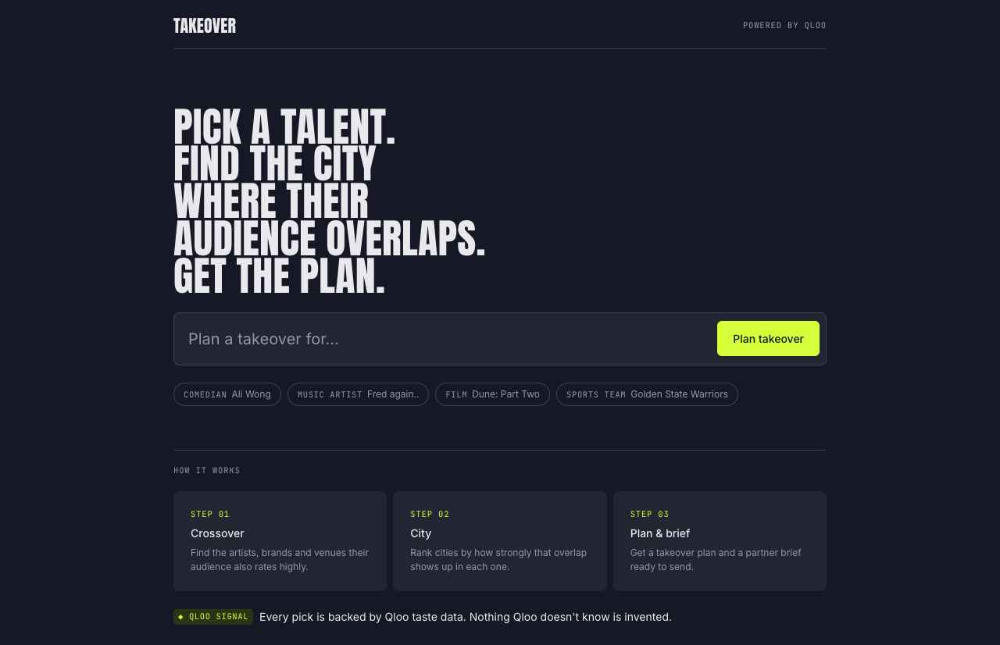
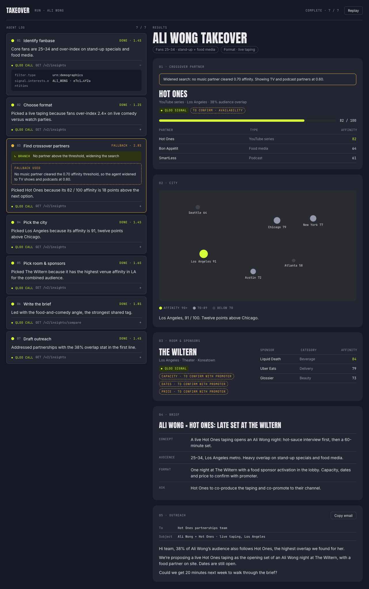
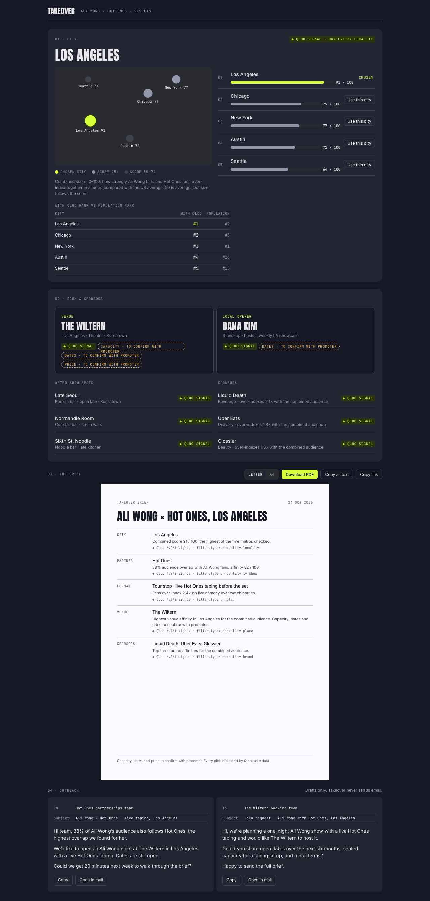

# Qloo

> Work in progress. Feature code has not been written yet.

A Next.js (App Router) app that combines the Qloo Taste AI API with a Claude-driven agent to build plans, alongside an LLM-only route for comparison.

## Screens

Design screens from the Claude Design hand-off in [`design/`](design/design_handoff_takeover/). They show
placeholder sample data (names and figures are illustrative), not Qloo results.

| Landing | Run |
| --- | --- |
|  |  |



## Stack

- Next.js (App Router) + TypeScript
- Tailwind CSS
- ESLint
- Vitest

## Layout

| Path | Purpose |
| --- | --- |
| `lib/qloo/` | Qloo API client |
| `lib/engine/` | Scoring logic (pure functions) |
| `lib/agent/` | Agent tool loop and tool definitions |
| `app/api/plan/` | Plan route (Server-Sent Events) |
| `app/api/llm-only/` | LLM-only comparison route |
| `components/` | React components |
| `tests/` | Vitest tests |
| `scripts/` | Dev and maintenance scripts |

## Getting started

```bash
npm install
cp .env.example .env.local   # then fill in the keys
npm run dev                  # http://localhost:3000
```

## Scripts

| Command | Does |
| --- | --- |
| `npm run dev` | Start the dev server (`TAKEOVER_MOCK=1 npm run dev` for sample data) |
| `npm run build` | Production build |
| `npm run lint` | Run ESLint |
| `npm test` | Run Vitest once |
| `npm run test:watch` | Run Vitest in watch mode |
| `npm run typecheck` | Type-check with `tsc --noEmit` |
| `npm run test:e2e` | Playwright end-to-end tests; builds and starts the app in mock mode (or set `PLAYWRIGHT_BASE_URL`) |
| `npm run probe` | Record raw Qloo responses into `tests/fixtures/` (needs a key) |
| `npm run scan:secrets` | Fail if a key or `.env` file is in the bundles or the repo (run after build) |
| `npm run warm-cache` | Preload example runs into Redis (stub until the probe runs) |

## API

| Route | Does |
| --- | --- |
| `POST /api/plan` | `{query, overrides?}` → SSE stream of agent events and a final plan |
| `POST /api/llm-only` | `{query}` → the same model's answer with no tools or Qloo data |
| `GET /api/health` | Qloo reachability, Redis status, limits and remaining daily runs; no secrets |

## Environment

See `.env.example`: `QLOO_API_KEY`, `QLOO_BASE_URL`, `ANTHROPIC_API_KEY`, `UPSTASH_REDIS_REST_URL`, `UPSTASH_REDIS_REST_TOKEN`, plus `TAKEOVER_MOCK` and `TAKEOVER_DAILY_RUNS`. Without `ANTHROPIC_API_KEY` the agent runs a scripted planner with template prose; without Upstash, caches and limits fall back to memory.

## Data credits

City names, regions, coordinates and populations come from [GeoNames](https://www.geonames.org/)
(`cities15000`), licensed under [CC BY 4.0](https://creativecommons.org/licenses/by/4.0/). We keep
cities with population of 100,000 or more in `lib/engine/data/cities.json`; regenerate it with
`npx tsx scripts/build-cities.ts`.

## License

MIT. See [LICENSE](LICENSE). Third-party data keeps its own licence (see Data credits).
