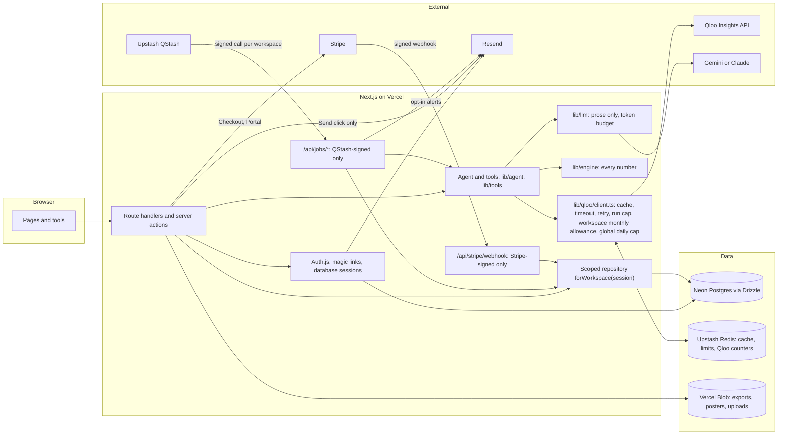

# Architecture: Takeover as a team product (proposal)

Status: **foundation built on branch `roadmap/foundation`**: database, auth, workspaces, plans,
comments, rosters, the Qloo budget scopes and the job queue (sections marked *Built*). Blob and Stripe are still proposals. The rules this
design must keep are in [roadmap-rules.md](roadmap-rules.md).

## What changes and what stays

The public site stays as it is, with no sign-in: plans, tools, Daily, city pages, shared links.
That is the growth loop. Signing in adds a **workspace**, where a team can:
- save plans and keep notes on them
- enter its own data (ticket sales, fees, constraints)
- track outreach
- watch fanbases and cities for changes
- export branded decks
- pay

Redis (Upstash) keeps the jobs it does today: the Qloo response cache, rate limits, the token
budget, votes and trending. It also takes on the two new Qloo counters, because they must be
atomic and fast. Postgres holds everything a customer owns.

## The parts

| Part | Choice | Why |
| --- | --- | --- |
| Database | **Neon Postgres** with **Drizzle ORM** (*Built*) | On the Vercel Marketplace, branch databases for previews; Drizzle gives typed SQL and SQL-first migrations we can read. Production uses the `postgres` driver on Neon's pooled URL (transactions work, unlike the HTTP driver). Local dev, unit tests and e2e use **PGlite** (Postgres in WebAssembly) with the same migrations; Vercel refuses to start without `DATABASE_URL`. |
| Auth | **Auth.js (v5)** with email magic links, the Drizzle adapter, database sessions (*Built*) | No passwords to store. Sessions live in Postgres, so they can be revoked. Requests without a session cookie never touch the database. |
| Email | **Resend** (*Built* for sign-in and invites) | Sign-in links, invites, later opt-in alerts and outreach the user clicks Send on. Without `RESEND_API_KEY`, local runs and e2e use an in-memory outbox at `/dev/outbox`; it never exists on Vercel, where sending fails closed. |
| Background jobs | **Upstash QStash** (*Built* for roster refreshes) | Already on Upstash. Signed HTTP calls to our own routes, with retries, delays, schedules and a dead-letter queue. One message per workspace, so a failure never stops everyone's job. |
| Files | **Vercel Blob** (*Built* for uploaded data files, private) | Exported decks and PDFs, posters, uploaded CSVs and XLSX files of ticket sales. Without `BLOB_READ_WRITE_TOKEN`, local runs keep files under `.data/uploads` (memory in tests and e2e); a Vercel deployment without it refuses uploads. |
| Billing | **Stripe** | Checkout to subscribe, the Customer Portal to change or cancel, webhooks to sync the plan. |

Alternatives considered:
- **Database:** Supabase (it adds its own auth and storage, which would overlap with Auth.js and
  Blob) and Vercel Postgres (now provided by Neon).
- **Jobs:** Vercel Cron. It is simpler, but the Hobby plan runs a job at most once a day, and it
  has no retries or per-workspace fan-out. Vercel Cron could trigger the daily schedule with
  QStash fanning it out, but QStash schedules make the cron unnecessary.

## Diagram

## Data model (first cut)

Every table except the identity tables has `workspace_id uuid not null` and an index that
starts with it.

| Table | Holds | Scope |
| --- | --- | --- |
| `users`, `accounts`, `sessions`, `verification_tokens` | Auth.js identity | Per person (identity only) |
| `workspaces` | name, plan, Stripe customer id | The tenant itself, keyed by `id` |
| `memberships` | `workspace_id`, `user_id`, role (owner, admin, member, viewer) | workspace |
| `invites` | email, hashed token, expiry, invited by | workspace |
| `plans` (*Built*) | run id, input, the stored plan JSON, created by, visibility (workspace or public), imported from | workspace |
| `comments` (*Built*) | plan, target (plan, partner, city, venue, sponsor) and its id, parent (one level of threading), author, body, resolved | workspace |
| `notifications` (*Built*) | in-app @mentions | workspace |
| `activity_log` (*Built*) | who did what | workspace |
| `datasets` (*Built*, in place of `user_facts` for uploads) | file name, kind, private file key, city and country columns, metrics, attached fanbase, `source = 'user'`, uploaded by, uploaded at | workspace |
| `dataset_rows` (*Built*) | raw city and country, matched GeoNames metro, match status (matched, manual, ambiguous, unmatched, skipped), metric values, `source = 'user'` | workspace |
| `user_facts` | single facts typed in: fees, constraints | workspace |
| `sponsor_matches` (*Built*) | a rights holder and a brand on the shortlist, with the engine's fit, evidence and pitch input | workspace |
| `plan_predictions` (*Built*) | a plan's predictions (chosen city, partner, venue, sponsors with ranks and scores), frozen when the plan is saved | workspace |
| `outcomes` (*Built*) | results logged after the event: attendance, tickets sold, capacity, gross, sponsor renewed, notes; `source = 'user'`, logged by, logged at | workspace |
| `calibration_pairs` (*Built*) | predicted score and confidence beside sell-through, stored for later calibration, never used to change scores | workspace |
| `outreach` (*Built*, Feature 7) | one draft to one recipient: source (plan or sponsor match), kind, context, recipient, email (user data), subject, body, stage (drafted, sent, replied, negotiating, booked, lost), owner, `sent_by`, `sent_at`, content hash | workspace |
| `outreach` (Feature 7, second part) | adds contact name, follow-up date, notes (user data) and the date last reminded; any member can own a card | workspace |
| `outreach_events` (*Built*) | every stage move: who, when, from, to; a move to sent keeps a copy of what was sent and to whom | workspace |
| `send_confirmations` | one-time token for one draft's content hash, expiry. Not built: Takeover does not send outreach (decision D128); needed only if a Send button is added | workspace |
| `watch_items` (*Built*) | a fanbase (Qloo entity) or city (GeoNames metro) to watch, last and next check, last note | workspace |
| `snapshots` (*Built*) | per item and week: ranked top lists (entity ids, ranks, values) and the Qloo requests | workspace |
| `alerts` (*Built*) | a change between two snapshots: kind, list, entity, before, after, templated title and body | workspace |
| `digest_subscriptions` (*Built*) | per person and workspace: digest on or off, last sent | workspace |
| `job_runs` (*Built*) | job kind, target, status (queued, running, done, failed, skipped_budget), Qloo calls used, note | workspace |
| `rosters` (*Built*) | name, created by | workspace |
| `roster_acts` (*Built*) | roster, Qloo entity id, name, type, resolver snapshot, home city (user data), added by, Qloo affinities to the other acts and when | workspace |
| `entity_profiles` (*Built*) | per Qloo entity: best city, partner, sponsor and per-city heat, refreshed at; keyed live or sample | Shared: Qloo data about a public entity, not customer data |
| `tours` (*Built*) | a Tour optimizer result saved from its server-side draft (the engine's route, scores and requests), with the user's window and per-stop dates and venue sizes (user data) | workspace |
| `exports` | Blob path, kind (deck, PDF, CSV, poster), created by | workspace |
| `subscriptions` | Stripe subscription id, price, status, current period end | workspace |
| `audit_log` | who did what (invite, role change, send, export, billing) | workspace |

`datasets`, `dataset_rows` and `user_facts` stay separate from anything Qloo produced, so the "Your data" label is a property
of where a value comes from, not something added by hand when it is shown.

## How the rules are enforced

### Workspace scoping (rule 3)

- `lib/db/index.ts` creates the Drizzle client. Only `lib/db/scoped.ts` and admin scripts may
  import it, and an ESLint `no-restricted-imports` rule enforces that.
- `forWorkspace(session)` checks that the user is a member of the workspace, then returns
  repository functions that add `workspace_id` to every `where` and every insert.
- In tests, the Drizzle logger records SQL and `expectAllScoped()`
  (`tests/support/scoped-queries.ts`, already written and tested) fails on any workspace table
  touched without a `workspace_id` condition.
- Later, as a second layer: Postgres row-level security, with the workspace id set per
  transaction. It is not in the first cut because the HTTP driver has no long-lived sessions to
  carry the setting.

### Qloo budget (rule 4) (*Built*)

Built in `lib/qloo/allowance.ts` and `lib/qloo/client.ts`. Without Redis (local runs, mock mode,
tests) the counters live in process memory. `QLOO_WORKSPACE_MONTHLY_CALLS` defaults to 500 and
there is no daily cap unless `QLOO_DAILY_CALL_CAP` is set; the job reserve then defaults to a tenth
of the cap. Signed-in plan runs, roster searches and roster refreshes are charged to the
workspace; roster batches from the queue are charged as jobs.

The client's `get(path, params, { runId })` gains a `scope`:
`{ kind: "visitor" } | { kind: "workspace", workspaceId } | { kind: "job", workspaceId }`.

Before each uncached call, one Redis script atomically:

1. checks and increments `qloo:daily:<UTC date>` against `QLOO_DAILY_CALL_CAP`;
2. for a job, refuses if fewer than `QLOO_JOB_RESERVE` calls of the daily cap are left, which
   keeps a share for people using the site;
3. for a workspace or a job, checks and increments `qloo:ws:<id>:<YYYY-MM>` against that
   workspace's allowance. The allowance comes from its plan, falling back to
   `QLOO_WORKSPACE_MONTHLY_CALLS`.

If any check fails, nothing is incremented and the call throws `BudgetExceededError` with the
limit's name. Cache hits are never counted. The existing per-run cap of 25 stays as it is. The
health page shows today's global count and the cap.

### Email (rule 5)

- `lib/email/send.ts` is the only module that calls Resend. It has two entry points:
  - `sendToSelf(userId, template)`: sign-in, invites and opt-in alerts.
  - `sendOutreach(confirmationToken)`: everything else.
- `sendOutreach` checks the token, its expiry and that it is single-use. It also checks that the
  draft's content hash still matches what the user saw when they clicked. Then it sends, writes
  `outreach.sent_*` and the audit log, and burns the token.
- Jobs and the agent cannot mint confirmation tokens; only the Send server action can. A unit
  test checks that no file under `lib/agent`, `lib/tools` or `app/api/jobs` imports
  `sendOutreach`.
- *Built so far (D128):* the outreach pipeline tracks drafts but sends nothing, as the design says
  ("Takeover never sends email"). The user sends from their own email and marks the card sent; that
  move must carry the hash of the draft they saw, and the log keeps a copy. `sendOutreach` and
  `send_confirmations` are not built. A unit test checks that no pipeline module, route or screen
  imports `lib/email`, and that nothing under `lib/agent` or `lib/tools` touches the pipeline.

### User data (rule 2)

- Each value is read with its `source`. The UI component for a user value always renders the
  **Your data** label.
- A combined view (for example Qloo affinity next to sell-through) is built by code in
  `lib/engine` and shows both parts and the rule that joins them.

## Background jobs (first ones)

| Job | Schedule | Qloo calls | Output |
| --- | --- | --- | --- |
| Watch refresh (*Built*) | Weekly per workspace, Monday 07:00 in the workspace's time zone (UTC when not set): an hourly QStash schedule calls `/api/jobs/watch-tick`, which sends one message per workspace with a watch due, 30 s apart, to `/api/jobs/watch-refresh` | 3 per fanbase, 4 per city; checked against the workspace allowance and the daily cap (keeping the job reserve) before each item, skipped and logged when over | Snapshots, alerts in Market watch, and the digest to members who turned it on |
| Export render | On click | None | A deck or PDF in Blob |
| Stripe sync | On webhook | None | `subscriptions` and `workspaces.plan` |
| Usage rollup | Daily | None | Copies the Redis counters into Postgres for the usage page and billing |

Job routes check the QStash signature, read `workspace_id` from the payload, load that
workspace through the scoped repository, and record a `job_runs` row whatever happens.

*Built:* **Roster refresh** (on click). A refresh is planned first: its upper-bound call count is
shown and checked against the workspace's remaining allowance (and the daily cap) before anything
runs. Up to 25 calls run in the request; more are split into batches of at most 25 and published to
QStash 30 seconds apart (`/api/jobs/roster-refresh`, signature checked with `node:crypto`). Each
job acts as the member who asked, with their current role, and does nothing if they left or the
job is no longer queued. Locally the queue is an in-process timer; on Vercel without
`QSTASH_TOKEN` and `APP_URL` large refreshes are refused, small ones still run.

## Files

- **Posters:** shared on purpose, so they are public in Blob, under random paths.
- **Exports and uploads:** customer data. They are served through
  `/api/files/[id]`, which checks the session's workspace before streaming from Blob. Whether
  Vercel Blob's private access mode should be used instead is checked when it is installed.
- **Uploaded CSVs and XLSX** (*Built*): read in the browser for the preview and again on the
  server (CSV parser; XLSX unzipped with `fflate`, XML read directly; up to 5 MB and 5,000 rows),
  stored in `datasets` and `dataset_rows` with `source = 'user'`. The file is put in Vercel Blob
  with `access: "private"`; it is never served back, only deleted. One click deletes the rows,
  the dataset and the file.

## Billing

- **Plans:** Free (today's site, plus one workspace with a small Qloo allowance), Pro and Team.
  Each plan sets seats and the monthly Qloo allowance.
- **Flow:**
  - Checkout runs from a server action, so no Stripe key reaches the browser.
  - The webhook (signature checked) updates `subscriptions` and `workspaces.plan`.
  - The Customer Portal handles changes and cancellations.
- **Prices:** set in Stripe and referenced by price id. The app never states a price it did not
  read from Stripe.
- **Before charging:** a commercial Qloo agreement, terms and a privacy policy
  (docs/go-to-market.md).

## New environment variables

All are server-only. None has a `NEXT_PUBLIC_` prefix.

| Variable | Used by | Notes |
| --- | --- | --- |
| `DATABASE_URL` | Drizzle (runtime) | Neon pooled connection string |
| `DATABASE_URL_UNPOOLED` | drizzle-kit migrations | Neon direct connection |
| `AUTH_SECRET` | Auth.js | Random 32+ bytes |
| `AUTH_URL` | Auth.js | Only outside Vercel; Vercel sets the host |
| `RESEND_API_KEY` | Resend | Also passed to the Auth.js Resend provider |
| `EMAIL_FROM` | Resend | For example `Takeover <hello@your-domain>`, on a verified domain |
| `APP_URL` | Emails, QStash callbacks, Stripe return URLs | The public base URL |
| `QSTASH_TOKEN` | Publishing and scheduling jobs | |
| `QSTASH_CURRENT_SIGNING_KEY` | Verifying job calls | |
| `QSTASH_NEXT_SIGNING_KEY` | Verifying job calls during key rotation | |
| `BLOB_READ_WRITE_TOKEN` | Vercel Blob | Set automatically when a Blob store is linked |
| `STRIPE_SECRET_KEY` | Checkout, Portal | |
| `STRIPE_WEBHOOK_SECRET` | Webhook signature | |
| `STRIPE_PRICE_PRO` | Checkout | Price id |
| `STRIPE_PRICE_TEAM` | Checkout | Price id |
| `QLOO_DAILY_CALL_CAP` | Qloo client | Global calls per UTC day |
| `QLOO_JOB_RESERVE` | Qloo client | Calls of the daily cap that jobs may not use |
| `QLOO_WORKSPACE_MONTHLY_CALLS` | Qloo client | Default allowance when a plan sets none |

## Build order (after approval)

1. **Database and the scoped repository.** Neon, Drizzle, a migration, `forWorkspace`, the
   ESLint import rule, and the logger wired to `expectAllScoped`.
2. **Qloo client scopes and the two counters.** Tests for each limit and for the job reserve.
   (*Built* with rosters.)
3. **Auth.js magic links and workspaces.** Invites, memberships, a sign-in page in the design
   system, and saved plans moved from the browser into the workspace.
4. **User data.** `user_facts`, the "Your data" label, and the CSV upload to Blob. (*Built* as
   datasets: upload, column mapping, GeoNames matching, attach to a fanbase, combined ranking.)
5. **Outreach tracking and Send with confirmation.** Through Resend. (*Built*: tracking, as the
   outreach pipeline. Send stays with the user's own email; see D128.)
6. **Watches and the weekly job.** Through QStash. (*Built*: Market watch. To schedule it, create a
   QStash schedule with cron `0 * * * *` (hourly, so each time zone's Monday morning is caught) and
   destination `<APP_URL>/api/jobs/watch-tick`.)
7. **Stripe.** Plans, Checkout, webhook, Portal.

Each step lands with tests, passing checks and a decision entry, and is committed on its own.
